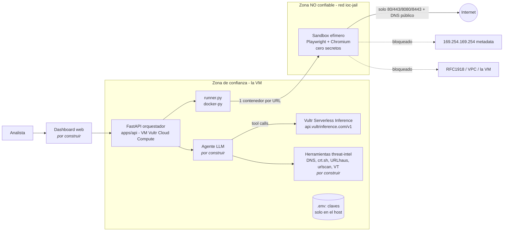
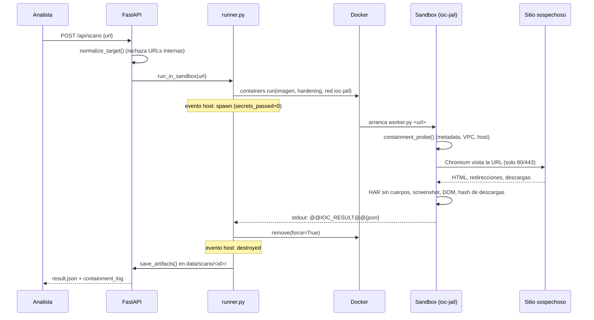
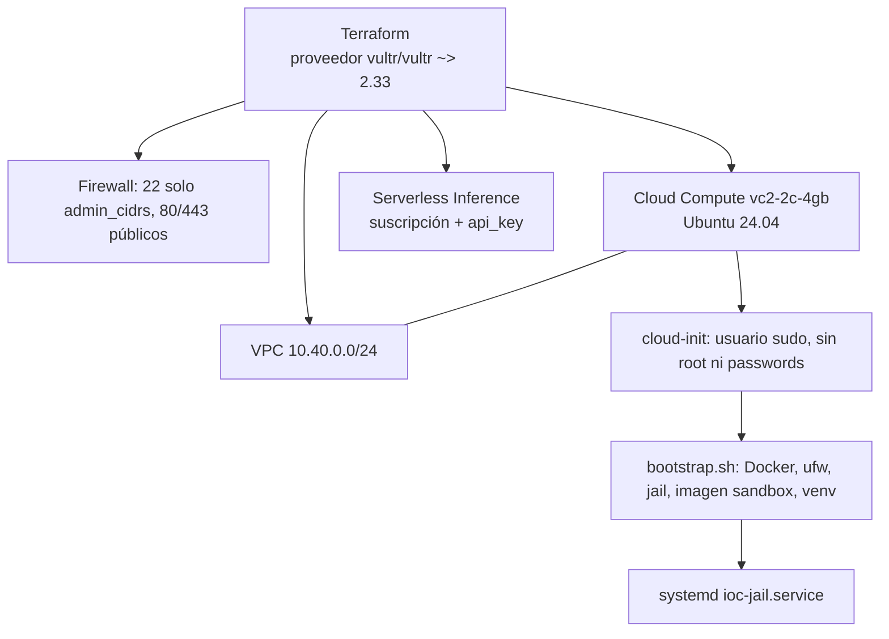

# IoC Sentinel - Arquitectura y funcionamiento

Este documento describe cómo funciona IoC Sentinel **según el código actual** (Día 1). Lo que aún no existe
está marcado como _(por construir)_.

## 1. Qué hace y qué amenaza contiene

Un analista entrega una URL/dominio sospechoso. El sistema la **visita en un navegador real** y devuelve
evidencia forense (Indicators of Compromise): dominios, IPs, cadena de redirecciones, certificado TLS,
formularios de robo de credenciales, hashes de descargas y una captura de pantalla.

El riesgo es obvio: la página es hostil. Puede intentar:

| Ataque de la página | A qué apunta | Qué lo detiene |
|---|---|---|
| `fetch` a `169.254.169.254` | metadata de la nube (credenciales de la VM) | jail de red (iptables) |
| `fetch` a `10.x` / `192.168.x` | VPC y redes internas | jail de red |
| Conexión a la propia VM (SSH, API :8000) | el orquestador y sus secretos | regla INPUT de la jail |
| Descarga drive-by | ejecutar malware | tmpfs `noexec`, se hashea y se borra |
| Texto oculto "ignora tus instrucciones..." | secuestrar al agente LLM | el contenido se trata como **dato** _(prompt del agente: por construir)_ |
| Bomba de memoria / fork bomb / página colgada | agotar la VM | límites de mem/CPU/pids + timeout + kill |

**Principio "Blast Radius Zero":** si el sandbox se compromete, lo máximo que se pierde es un contenedor
efímero sin secretos y sin ruta de red hacia nada que importe.

## 2. Componentes



| Componente | Archivo | Rol |
|---|---|---|
| API | `apps/api/app/main.py` | `POST /api/scans`, `GET /api/scans/{id}` (+ `screenshot.png`, `session.har`) |
| Validación de URL | `apps/api/app/sandbox/url_guard.py` | rechaza IPs no públicas, `localhost`/`.internal`/`.local`, credenciales en la URL, esquemas que no sean http(s), URLs >2048 |
| Runner | `apps/api/app/sandbox/runner.py` | crea, vigila y destruye el contenedor; construye el Containment Log |
| Worker del sandbox | `sandbox/browser/worker.py` | dentro del contenedor: visita la URL y emite UNA línea JSON |
| Config | `apps/api/app/config.py` | límites del sandbox y claves (solo host) |
| Cliente de inferencia | `apps/api/app/inference/client.py` | cliente OpenAI-compatible hacia Vultr Serverless Inference |
| Jail de red | `infra/vm/jail-network.sh` | red Docker `ioc-jail` + iptables |
| Infra | `infra/terraform/` | VPC, firewall, VM, suscripción de inferencia |

## 3. Frontera de confianza

- **Host (confiable):** guarda todos los secretos (`.env` en la VM) y ejecuta las herramientas que
  necesitan credenciales.
- **Sandbox (no confiable):** recibe solo `argv[1]` = la URL y dos variables (`NAV_TIMEOUT_MS`, `DWELL_MS`).
  El evento `spawn` registra `secrets_passed: 0`.
- **Canal de salida único:** el worker imprime una línea `@@IOC_RESULT@@{json}` por stdout. El host la
  lee desde los logs del contenedor; no hay volúmenes ni sockets compartidos.
- Todo lo que sale del sandbox (texto de la página, URLs, cabeceras) es **dato no confiable**. Nunca se
  interpreta como instrucción.

## 4. Capas de contención (defensa en profundidad)

1. **Validación de entrada** (`normalize_target`): primera barrera, en el host.
2. **Contenedor endurecido** (`_hardening_kwargs` en `runner.py`):
   rootfs de solo lectura · `cap_drop=ALL` · `no-new-privileges` · usuario no root (`pwuser`) ·
   `mem_limit=1g` y `memswap_limit` igual (sin swap) · 1 CPU · `pids_limit=512` ·
   `/tmp` en tmpfs `rw,noexec,nosuid,nodev,256m` · `nofile=1024` · IPC privado ·
   logs acotados a 50 MB · runtime opcional gVisor (`SANDBOX_RUNTIME=runsc`).
3. **Red jail** (`jail-network.sh`, cadena `IOC-JAIL` enganchada en `DOCKER-USER`, más regla en `INPUT`):
   - bloquea `169.254.0.0/16`, `10/8`, `172.16/12`, `192.168/16`, `100.64/10`, loopback, multicast y reservadas;
   - bloquea todo el tráfico de la jail hacia la propia VM;
   - DNS solo a `1.1.1.1` y `9.9.9.9`; salida TCP solo a 80/443/8080/8443; UDP/QUIC rechazado;
   - IPv6 deshabilitado en el bridge; `enable_icc=false` (contenedor↔contenedor);
   - cada bloqueo se registra (`IOC-JAIL-BLOCK/PORT/HOST`);
   - `infra/systemd/ioc-jail.service` reaplica las reglas al arrancar.
4. **Ciclo de vida**: timeout de 60 s → `kill`; detección de `OOMKilled`; `container.remove(force=True)`
   en el `finally`, pase lo que pase.
5. **Autoprueba desde dentro** (`containment_probe` en el worker): intenta conectarse a metadata,
   10.0.0.1, 192.168.0.1 y al gateway (SSH :22 y API :8000). Cada resultado entra al log; todos deben ser
   `blocked(...)`. Si alguno dice `REACHABLE`, la contención falló.

## 5. Flujo de un escaneo



### Containment Log

Une los eventos del host y del sandbox ordenados por tiempo. Ejemplo (de `docs/DIA1.md`):

```
[host   ] spawn              {... "secrets_passed": 0}
[sandbox] containment_probe  cloud-metadata 169.254.169.254:80  blocked(No route to host)
[sandbox] containment_probe  docker-host-ssh 172.30.0.1:22      blocked(...)
...
[host   ] destroyed          {"ms": ~10}
```

Eventos posibles: `spawn`, `running`, `sandbox_start`, `containment_probe`, `request_failed`,
`navigation_error`, `download_captured`, `screenshot_captured`, `har_captured`, `sandbox_done`,
`timeout_kill`, `oom_kill`, `no_result`, `error`, `destroyed`, `destroy_failed`.
Este log es la evidencia que se muestra en el video de la hackathon.

## 6. Qué se observa y cómo se mapea a IoCs

Categorías según la guía de CrowdStrike (red, archivo, comportamiento...):

| Tipo de IoC | Fuente en el resultado del sandbox |
|---|---|
| Red: dominios/hosts contactados | `hosts`, `requests` |
| Red: IPs de servidor | `server_ips` |
| Red: accesos por IP literal (típico de C2/kits) | `ip_literal_hosts` |
| Red: cadena de redirección y URL final | `redirect_chain`, `final_url`, `status` |
| Red: certificado TLS | `tls` (se acepta HTTPS inválido a propósito) |
| Archivo: hashes de descargas | `downloads[].sha256`, `md5`, `size`, `suggested_filename` |
| Comportamiento: robo de credenciales | `dom.forms[].has_password` + `action` hacia otro dominio |
| Comportamiento: recursos incrustados | `dom.scripts`, `dom.iframes`, `dom.links`, `meta_refresh` |
| Contexto visual | `screenshot.png`, `session.har` (solo metadatos), `dom.favicon` |
| Texto de la página (no confiable) | `dom.text_excerpt` (4000 caracteres) |

_(Por construir)_ `ioc/consolidate.py` normalizará esto a IoCs tipados con veredicto y evidencia, y las
herramientas del host añadirán reputación (URLhaus, crt.sh, DNS/WHOIS, urlscan, VirusTotal).

## 7. Capa de agente _(por construir)_

Bucle de tool-calling sobre **Vultr Serverless Inference** (requisito del Track 01):

1. El agente recibe la URL y decide qué herramientas llamar: `sandbox_scan` (envuelve `run_in_sandbox`)
   y las de threat-intel (que usan las claves del host).
2. Cada resultado del sandbox se entrega al modelo dentro de un bloque delimitado como **datos
   no confiables**, con instrucción explícita de ignorar cualquier orden que contenga.
3. Pasos con efecto externo o la exportación del reporte requieren **aprobación humana**.
4. El agente consolida IoCs, asigna veredicto y genera el reporte (JSON/HTML; STIX 2.1 si hay tiempo).

El modelo concreto depende de `make check-models` (la documentación de Vultr indica tool calling solo en
`kimi-k2-instruct`; hay que confirmarlo). Si ningún modelo ve imágenes, el veredicto visual usa señales del DOM.

## 8. Despliegue en Vultr



| Servicio Vultr | Uso |
|---|---|
| Cloud Compute | VM que aloja la API, Docker y los sandboxes |
| Serverless Inference | LLM del agente (API OpenAI-compatible) |
| VPC | red privada del plano de control; la jail la bloquea desde el sandbox |
| Firewall | filtro de borde antes de iptables |
| Reserved IP (opcional) | IP estable para la URL pública de la demo |

La clave de inferencia nunca viaja en `user_data` (que se sirve desde la metadata `169.254.169.254`):
`make tf-env` la escribe en `.env` por SSH con permisos 600.

## 9. Operación

```bash
make smoke                          # aceptación: todos los probes bloqueados, 0 contenedores huérfanos
make scan URL=https://dominio.tld   # un escaneo desde CLI
make api                            # API en :8000 (docs en /docs)
make jail-status                    # contadores de bloqueos de la jail
make check-models                   # matriz de modelos: tool calling / visión
```

Artefactos de cada escaneo: `data/scans/<scan_id>/{result.json,screenshot.png,session.har}`.

## 10. Limitaciones conocidas

- Aún no hay agente, dashboard ni reporte consolidado.
- `ignore_https_errors=True` es intencional (queremos ver sitios con certificados inválidos).
- Chromium corre con `chromium_sandbox=False`: el aislamiento lo da el contenedor (y gVisor si se activa),
  porque el sandbox propio de Chromium no funciona con `cap_drop=ALL`.
- Un 0-day de Chromium + escape de contenedor sigue siendo posible en teoría; por eso la red y la ausencia
  de secretos importan más que cualquier capa individual. gVisor reduce ese riesgo.
- El estado de Terraform es local y contiene la clave de inferencia (está en `.gitignore`).
